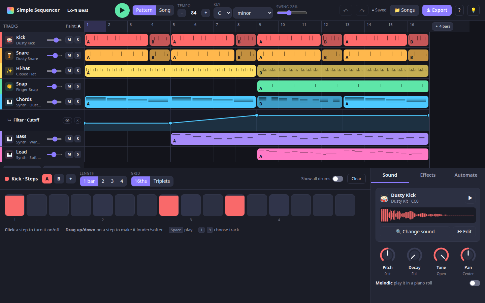

# Simple Sequencer

An approachable, browser-based multitrack beat sequencer. Build songs from drum and synth
tracks, patterns and a song timeline, with no account and no server.



## What you can do

- **Start playing straight away** with four ready-made templates: Lo-fi Beat, House, Hip-hop and Empty.
- **Drum and sample tracks** use a step grid. Drag up or down on a step to make it louder or softer. "Show all drums" shows the whole kit at once.
- **Synth tracks** have 10 presets and 4 friendly knobs (Tone, Punch, Space, Length), plus an Advanced drawer. Notes go in a **scale-locked piano roll**, so a note can't sound wrong, and a **chord stamp** places whole chords in one click.
- **Patterns** (A, B, C…, 1–4 bars, 16ths or triplets) are painted onto a **song timeline**.
- **Melodic samples**: play any sound in tune in the piano roll (piano, vocal chop…).
- **85 built-in sounds** in 4 drum kits, plus melodic, FX and vocal sounds. All are CC0 or CC-BY.
- **Your own sounds**: import WAV, MP3, OGG or FLAC, or **record from your microphone**.
- **Sample editor**: trim, reverse, tune, loop, fade and normalize. Edits never change the original file.
- **Effects**: 8 curated effects per track (Reverb, Delay, Filter, Distortion, Compressor, EQ, Chorus, Bitcrush), each reorderable by drag. An always-on limiter stops the song from distorting.
- **Automation lanes**: draw how a knob moves over the song.
- **Saving and export**: autosave in your browser, a song library, `.json`/`.zip` song files, and **WAV/MP3 export**.
- **Help as you go**: undo/redo, keyboard shortcuts (press `?`), and a plain-English tooltip on every control.

## Run it

```bash
npm install
npm run dev
```

Open the printed localhost URL in Chrome, Firefox or Safari on a desktop.

## Test

```bash
npm run typecheck && npm run lint && npm test   # unit + Web Audio tests (headless Chromium)
npm run e2e        # Playwright: Chromium, Firefox, WebKit
npm run e2e:local  # Chromium + Firefox only (for hosts where WebKit can't launch)
npm run e2e:perf   # stress-song performance check (run alone; timing-sensitive)
```

The manual listening checklist is in [`docs/QA-CHECKLIST.md`](docs/QA-CHECKLIST.md).

## Deploy (GitHub Pages)

1. Create a GitHub repository and push `main`.
2. In the repository settings, go to **Pages** and set **Source: GitHub Actions**.
3. Every push to `main` runs `.github/workflows/deploy.yml`, which tests, builds and publishes `dist/`.

The build uses relative paths, so `dist/` can also be served from any static host. Microphone
recording needs HTTPS (or localhost).

## Sounds and licenses

- **App code**: MIT.
- **Built-in sounds**: listed in `samples-src/sources.json`, each with its source, author and license.
  - Most are **CC0** (public domain): the Sonic Pi sample library (originally from freesound.org) and the Versilian Community Sample Library.
  - The piano is the **Salamander Grand Piano** by Alexander Holm (**CC-BY 3.0**), credited in the app.
- **Excluded sources**: anything considered and rejected is listed with reasons in `samples-src/EXCLUDED.md`.
- **Rebuilding the library**: run `node scripts/build-samples.mjs` (needs `ffmpeg`). Entries with a `freesoundId` also need a free Freesound API token in `FREESOUND_TOKEN`.
- **MP3 encoder**: MP3 export uses [lamejs](https://github.com/shijinyu/lamejs) (**LGPL-3.0**). It ships unmodified as a separate file (`mp3.worker-*.js`) that only loads when you export an MP3.
